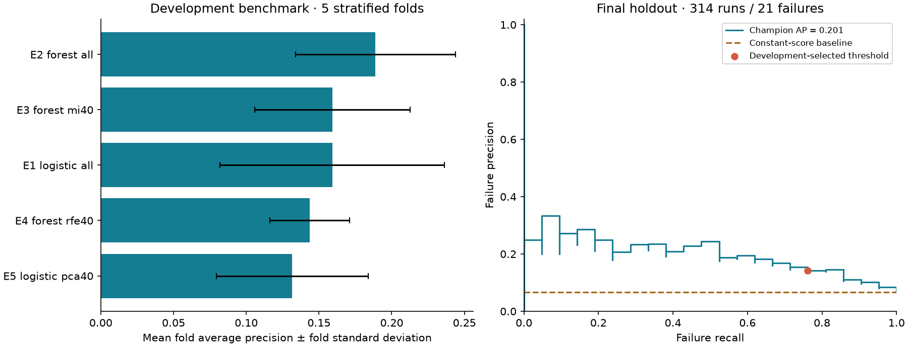

# Semiconductor Quality Lab

[](https://github.com/HarshaSanka/semiconductor-quality-lab/actions/workflows/ci.yml)

**Failure prediction and process analytics on real semiconductor manufacturing data.**

A personal AI/ML research engineering project connecting electronics, applied machine learning and reproducible experimentation. It evaluates manufacturing quality prediction on UCI SECOM, exposes a strict sensor-data inference contract, and presents the findings in a research dashboard.

**Measured result:** the selected Random Forest detected **16 of 21 holdout failures (76.2% recall)**, with **14.2% precision**, **97 false alarms**, **0.201 average precision** and **0.786 ROC-AUC**. The constant-score baseline AP was 0.067. These results support further investigation; the false-alarm burden prevents a claim of production usefulness.



## Start with the evidence

- [Measured research report](docs/RESULTS.md): protocol, results, intervals, time sensitivity and limitations.
- [Model card](docs/MODEL_CARD.md): intended use, inference contract and interpretation.
- [Offline interactive results viewer](docs/results_viewer.html): download/open in a browser; live prediction requires the local demo.
- [GitHub showcase and interview guide](docs/SHOWCASE.md): demo walkthrough and defensible resume wording.
- [Raw evaluation outputs](artifacts/results.json), [fold metrics](artifacts/fold_metrics.csv), [split indices](artifacts/split_manifest.json), [holdout predictions](artifacts/holdout_predictions.csv).

## What is implemented and what was verified

**GitHub verification:** [both core and full-dependency CI jobs passed](https://github.com/HarshaSanka/semiconductor-quality-lab/actions/runs/38766661775) on commit `30ddb2b`. The full job runs the API contracts and synthetic integration checks for XGBoost, SHAP additivity and MLflow artifact tracking. This verifies those integrations; it does not establish a full-profile SECOM benchmark, a deployed dashboard, Docker operation or BigQuery execution. The table below records the original local build checks.

| Component | Implementation | Verification in the build environment |
| --- | --- | --- |
| SECOM ingestion and provenance | Official-source downloader; local archive import; hashes and structural checks | Real archive imported, 1,567 × 590 matrix verified |
| Leakage prevention | Training-only filtering, imputation, scaling and selection in sklearn pipelines | Core contracts passed |
| Research benchmark | Logistic Regression, Random Forest, MI, RFE and PCA | Five configurations × five folds executed |
| Failure-focused evaluation | AP, ROC-AUC, precision, recall, F1, Brier, F2 threshold, bootstrap | Executed; final holdout contains 21 failures |
| Chronological sensitivity | Three expanding development windows, boundary timestamp purge | Executed; descriptive rather than prospective validation |
| Inference and SQL | Saved pipeline, artifact hash, CSV validation, SQLite research tables | CLI and SQL checked |
| Portable dashboard | Local Python server and offline results snapshot | Source checked; live binding blocked in this environment |
| XGBoost / SHAP / MLflow | Explicit full-profile training, explanations and experiment artifacts | Included; dependencies unavailable here, not executed |
| FastAPI / Streamlit | Batch API, four dashboard pages, API integration tests | Included; six API tests skipped here |
| Docker / BigQuery | Compose stack; explicit optional metrics exporter | Included; not executed |

The optional integrations must be installed and validated before claiming experience operating them in this project. This repository records an AI-assisted implementation; review the code, reproduce the experiments and make your own changes before presenting it as work you can independently maintain.

## Reproduce the core study

Use **Python 3.12** (3.11–3.13 supported). Run commands from the repository root.

```bash
python3.12 -m venv .venv
source .venv/bin/activate
python -m pip install -e '.[dev]'
secom-lab download
secom-lab train --profile core --seed 42 --folds 5
python scripts/build_report.py
python -m unittest discover -s tests -v
secom-lab predict artifacts/example_runs.csv
```

For an existing official archive, use `secom-lab download --archive /absolute/path/secom.zip`. The downloadable project package includes the public dataset and trained core artifact; Git excludes raw data and serialized models so the source repository stays small. Download/retrain after cloning.

`requirements-core-observed.txt` records the exact numerical-library versions used for the included results; `artifacts/results.json` records Python and package versions. For closest reproduction, install those versions before `pip install -e .`. This is an observed core environment record, not a complete transitive lock for the untested optional stack. Floating dependency ranges may produce different scores; regenerate results when changing the environment.

## Explore locally

After core training:

```bash
python -m secom_lab.demo
```

Open **http://127.0.0.1:8765**. Inspect results, compare experiments, download example runs and upload a 590-column CSV for live predictions. Alternatively open `docs/results_viewer.html` directly for an offline results snapshot; it intentionally disables live predictions.

CSV columns are exactly `sensor_000` through `sensor_589` in any order. Sensor indices are zero-based raw column positions. Blank cells represent missing values. The shared validator rejects duplicate/missing/extra columns, nonnumeric values, infinity, entirely missing runs, uploads over 10 MB and batches over 1,000 runs. Failure is positive class 1; original UCI label −1 maps to pass.

## Run the optional full stack

```bash
python -m pip install -e '.[full,dev]'
secom-lab train --profile full --output artifacts/full --tracking-uri sqlite:///mlflow.db
python -m unittest discover -s tests -v
# Terminal 1: serve the verified core model, or set SECOM_ARTIFACTS=artifacts/full
uvicorn secom_lab.api:app --host 127.0.0.1 --port 8000
# Terminal 2
streamlit run src/secom_lab/dashboard.py
# Terminal 3, optional experiment browser
mlflow ui --backend-store-uri sqlite:///mlflow.db --host 127.0.0.1
```

The full profile adds XGBoost with all sensors, RFE and PCA. It writes separate outputs to avoid replacing the published core study. Compare its development CV scores before interpreting its final results. Because the original holdout is already published, further choices informed by these results need a fresh independent evaluation to support confirmatory claims.

The Streamlit app calls FastAPI for predictions and SHAP explanations. `/schema` describes inputs, `/health` checks model readiness, `/predict` accepts `{"rows": [{"sensor_000": 1.2, "sensor_001": null, "...": "all remaining sensors"}]}`, and `/explain` accepts at most ten complete rows. Open http://127.0.0.1:8000/docs for the actual schema. Use the example CSV to construct complete rows; the abbreviated JSON above is illustrative, not a valid request.

```bash
docker compose up --build
```

Train on the host first; Compose mounts `artifacts/` read-only into both services. Ports bind to localhost. Docker packaging is provided but has not been executed in this environment. These development servers do not include internet-facing authentication or operational monitoring.

## Research design

1. Reserve a fixed stratified 20% holdout.
2. Benchmark five core configurations using identical five-fold development splits. Everything learned, including MI/RFE/PCA, is fitted inside each training fold.
3. Rank models by mean fold **average precision**, a non-interpolated precision–recall summary. It is not trapezoidal PR-AUC.
4. Select an F2-maximizing threshold from the winner's development out-of-fold predictions.
5. Fit the chosen pipeline on development rows. Evaluate that fixed choice once on the test set; compare with a constant-score baseline.
6. Report 1,000 stratified-bootstrap intervals and separate chronological development sensitivity checks. Do not interpret selected development scores as unbiased nested-CV estimates.

Models address class imbalance with class weighting; optional XGBoost uses balanced training-row sample weights. Median imputation is followed by constant-feature removal and scaling. Measurements with more than 50% training missingness are excluded. Large values are retained because physical sensor limits are unknown. Predictions are **uncalibrated scores**, and review flags are heuristics. SHAP units are explicitly labeled; PCA explanations refer to components.

## Data, SQL and cloud extension

SECOM has 1,567 runs, 104 failures and 590 raw measurement columns. UCI metadata reports 591 features; this project validates the raw file's actual width. Measurements are anonymized. Dataset download/import preserves source hashes in `data/raw/provenance.json`.

```bash
sqlite3 artifacts/research.sqlite < scripts/query_results.sql
python scripts/export_bigquery.py --table your-project.your_dataset.secom_experiments
# Optional real cloud write, after configuring your own Google credentials and dataset:
python -m pip install -e '.[cloud]'
python scripts/export_bigquery.py --table your-project.your_dataset.secom_experiments --execute
```

The exporter previews locally unless `--execute` is supplied; real exports can incur cloud costs. It appends benchmark metrics with an export identifier. No BigQuery execution or GCP deployment is claimed.

## Repository map

| Location | Purpose |
| --- | --- |
| `src/secom_lab/` | Data contracts, preprocessing, training, evaluation, inference and apps |
| `scripts/` | Report generation, SQL queries and optional BigQuery export |
| `tests/` | Leakage, schema, metric, artifact and optional API contracts |
| `artifacts/` | Measured outputs; trained executable model is ignored by Git |
| `docs/` | Results, figures, model card, offline viewer and showcase guide |
| `.github/workflows/ci.yml` | Core and full-dependency test jobs; no remote success implied |

Load only your own trusted `joblib` artifacts: deserialization executes Python code. The SHA-256 manifest detects accidental changes; it does not authenticate an untrusted model and manifest pair. Regenerate the model under your installed sklearn version rather than relying on cross-version compatibility.

## Scope and attribution

This project demonstrates transferable methods for semiconductor manufacturing research. It does not model 3D heterogeneous integration, implement DARPA NGMM, identify physical root causes, optimize manufacturing setpoints or demonstrate yield gains.

McCann, M., & Johnston, A. (2008). **SECOM** [Dataset]. UCI Machine Learning Repository. https://doi.org/10.24432/C54305. [Official dataset](https://archive.ics.uci.edu/dataset/179/secom), **CC BY 4.0**. Dataset-derived examples retain that attribution. Source code is offered under the [MIT license](LICENSE).

Technical references: [sklearn evaluation](https://scikit-learn.org/stable/modules/model_evaluation.html), [SHAP TreeExplainer](https://shap.readthedocs.io/en/latest/generated/shap.TreeExplainer.html), [XGBoost parameters](https://xgboost.readthedocs.io/en/stable/parameter.html), [MLflow tracking](https://mlflow.org/docs/latest/ml/tracking/).
