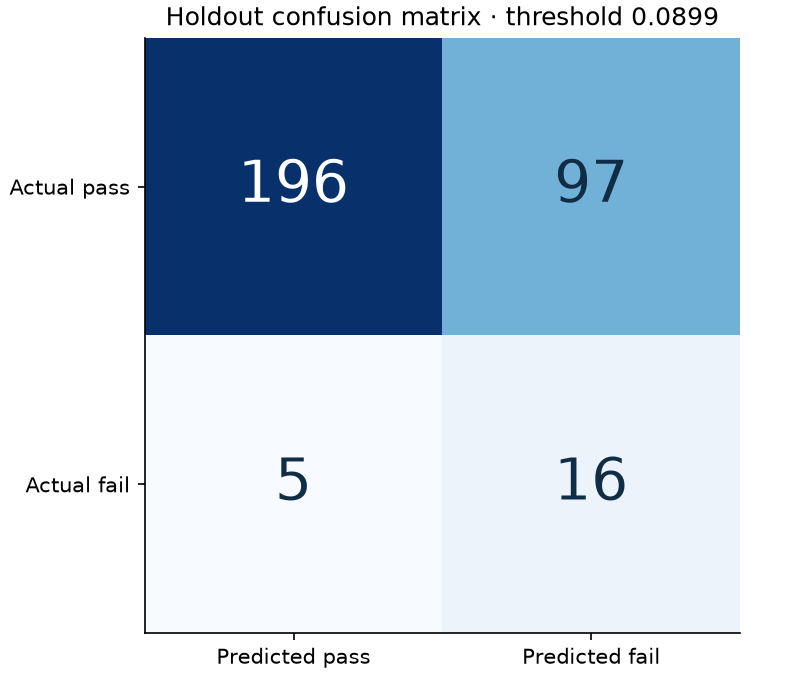
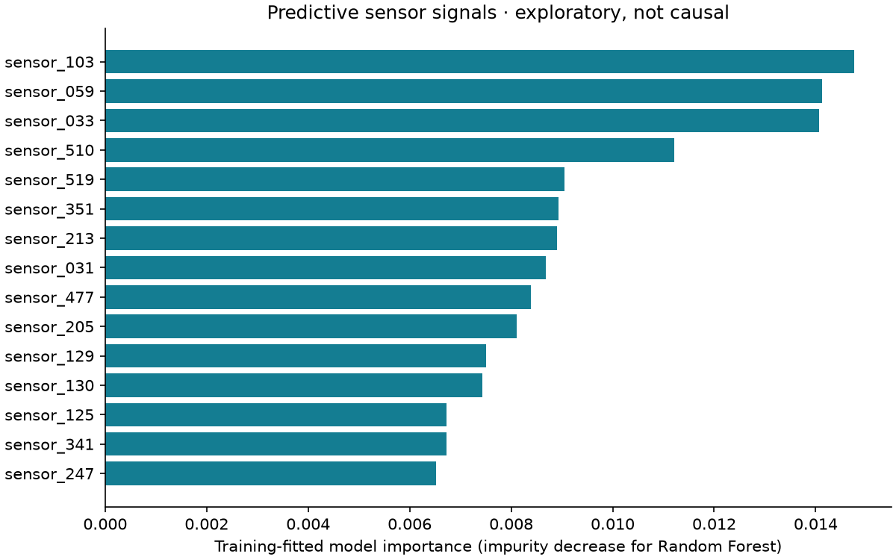

# Measured research results

This is a small-data predictive study, not a manufacturing optimization system. The core benchmark was executed on real SECOM measurements. The full optional stack was not executed in the build environment.

## Dataset and protocol

1567 runs, 590 anonymized measurements, 104 failures and 1463 passes. Missing measurements account for 4.54% of cells; 116 columns have at most one observed value. Sensor numbering is zero-based. Original labels −1 / +1 map to pass=0 / fail=1. UCI metadata reports 591 features; the verified raw matrix contains 590 measurement columns.

Use a seeded 80/20 stratified split: 1253 development rows and 314 holdout rows, including 21 failures. Every experiment uses the same five stratified development folds. Each fold learns its >50% missingness filter, median imputer, variance filter, scaler, selector and classifier using training rows only. Outliers are retained: without sensor semantics, removing large measurements could remove failure signals. Scaling and tree comparisons probe sensitivity; no physical outlier limits are invented.

Rank by mean fold **average precision (AP)**. AP is a non-interpolated precision–recall summary, not trapezoidal PR-AUC. Choose the winner before inspecting the holdout. Use that winner's out-of-fold development scores to maximize F2, weighting recall more than precision. These development selection statistics are optimistic after model/threshold selection; they are not nested-CV estimates.

## Development benchmark

| Experiment | CV AP mean | Fold SD |
| --- | ---: | ---: |
| E2_forest_all | 0.1889 | 0.0551 |
| E3_forest_mi40 | 0.1592 | 0.0535 |
| E1_logistic_all | 0.1591 | 0.0773 |
| E4_forest_rfe40 | 0.1436 | 0.0274 |
| E5_logistic_pca40 | 0.1317 | 0.0521 |

The selected model is **E2_forest_all**, with threshold **0.089873**. RFE uses a class-balanced logistic estimator and selects 40 variables; the final RFE experiment uses a forest. MI selects 40 variables. PCA retains 40 components. Class weights address imbalance; XGBoost's optional path uses per-training-fold balanced sample weights. The benchmark compares configurations, not a factorial causal study of each component.

## Final holdout evaluation

| Metric | Measured value | 95% interval |
| --- | ---: | --- |
| average_precision | 0.2008 | 0.1376–0.3635 |
| roc_auc | 0.7864 | 0.6925–0.8705 |
| precision | 0.1416 | 0.1103–0.1800 |
| recall | 0.7619 | 0.5714–0.9048 |
| f1 | 0.2388 | 0.1860–0.2975 |
| brier | 0.0589 | 0.0565–0.0613 |

The model detects **16 of 21 failures**, misses **5**, and flags **97 passing runs** as failures. It correctly passes 196 runs. Failure precision is only 14.2%; the false-positive rate is 33.1%. This is a substantial inspection burden. Default threshold 0.5 detects no failures; the development-selected threshold materially changes the operating point.

The constant-score baseline has AP 0.0669 and ROC-AUC 0.5000. Ranking performance exceeds that baseline on this holdout, but this result does not establish industrial usefulness. Scores are uncalibrated; Brier score is reported as a diagnostic, not proof of calibration. No per-run uncertainty interval is supplied.

Intervals use 1,000 stratified bootstrap resamples of holdout predictions with seed 42. They condition on observed class counts, do not repeat model selection or fitting, and assume independent runs. They understate uncertainty when runs are correlated and are especially fragile with only 21 failures.

## Chronological sensitivity

Sort development rows by timestamp and use three expanding windows. Purge training rows sharing the validation boundary timestamp. Window AP values are 0.1772, 0.2162, 0.1356. The earliest window raises many false alarms; later performance also varies. These checks demonstrate sensitivity to time and training-window size.

The model configuration and threshold were selected using all development rows, including later windows. Therefore these are descriptive chronological sensitivity checks, **not an independent prospective forecast evaluation**. The primary random holdout can also mix correlated production conditions across splits. No lot/equipment group identifiers are available to implement group holdouts.

## Interpretation and limitations

These are model importances learned on development data. Impurity importance can favor variables with many possible splits and distribute importance unpredictably among correlated sensors. It does not identify physical mechanisms. Optional SHAP explanations label their units and explain the actual served model; they do not establish causation. PCA explanations refer to latent components, not named physical sensors.

This historical 2008 dataset has anonymized measurements, few positive labels, unknown production grouping and possible drift. No causal process optimization, yield improvement, 3DHI result, DARPA endorsement or production deployment is claimed. Future work should pre-register a chronological/grouped evaluation, collect more failures and process context, calibrate scores with separate development data, evaluate inspection costs and validate prospectively.

## Reproducibility and execution status

Dataset SHA-256: `20f0e7ee434f7dcbae0eea9ffff009a2b57f42d6b0dc9a5bd4f00782c0a3374c`. Label SHA-256: `126884cf453705c9e61a903fe906f0665a3b45ce3639e621edc5c93c89627e03`. Split indices, fold metrics, OOF scores, holdout scores, model manifest and exact observed core versions are saved under `artifacts/`.

Executed: real-data core training, five configurations × five folds, final holdout, 1,000 bootstrap resamples, three time sensitivity checks, SQL storage, CLI predictions and core contract tests. Optional API tests are skipped when FastAPI/httpx are absent. XGBoost, SHAP, MLflow, Streamlit, Docker and BigQuery integrations are included but **not runtime-verified here**. Network dependency installation and localhost binding were unavailable. CI configuration is supplied; no remote CI success is claimed.

## Source

McCann, M., & Johnston, A. (2008). *SECOM* [Dataset]. UCI Machine Learning Repository. https://doi.org/10.24432/C54305. Dataset license: CC BY 4.0. The local archive was structurally checked and hashed; UCI does not supply an official checksum used by this project.
